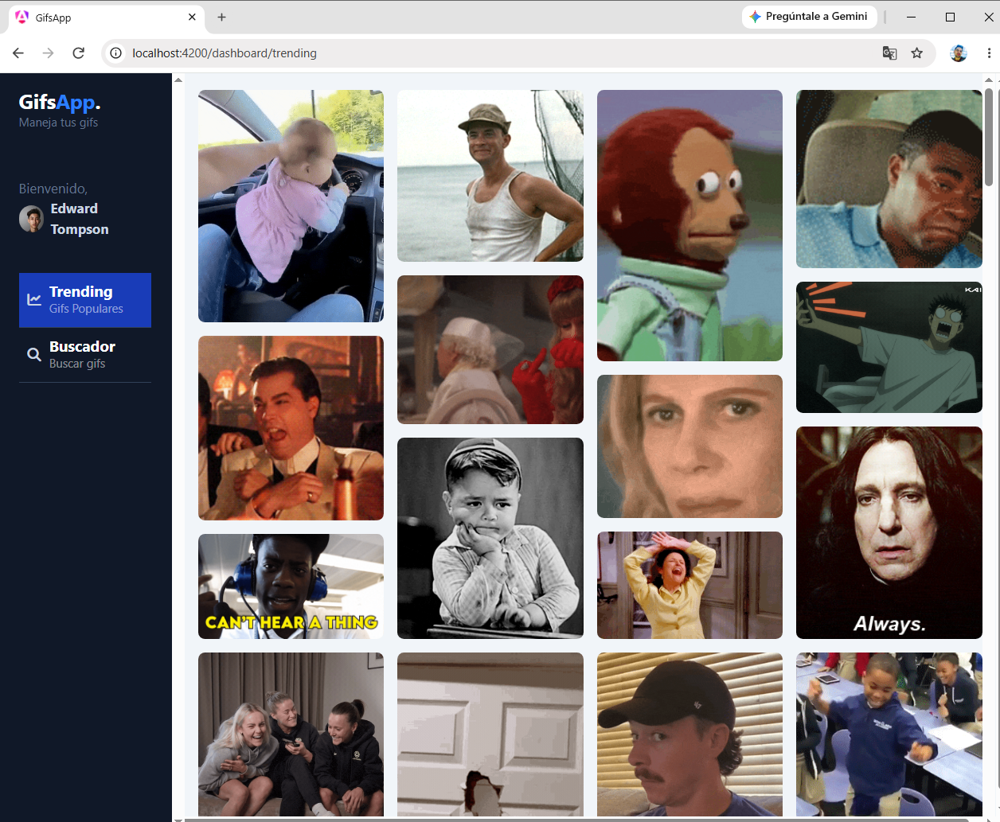
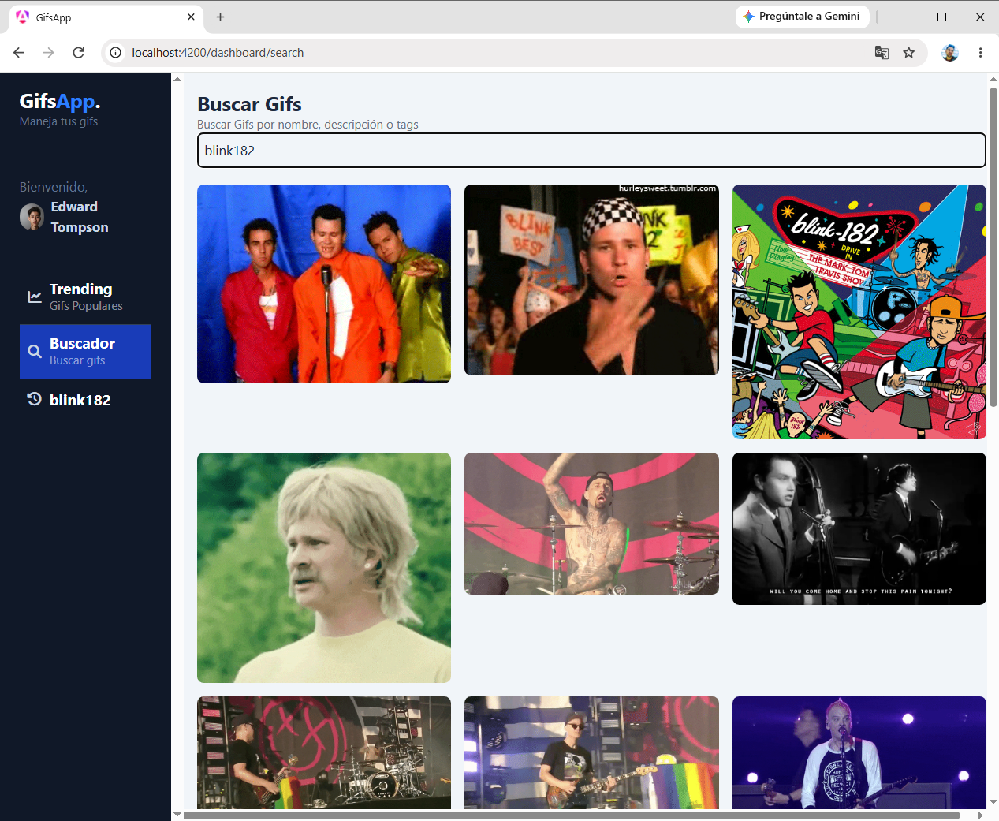
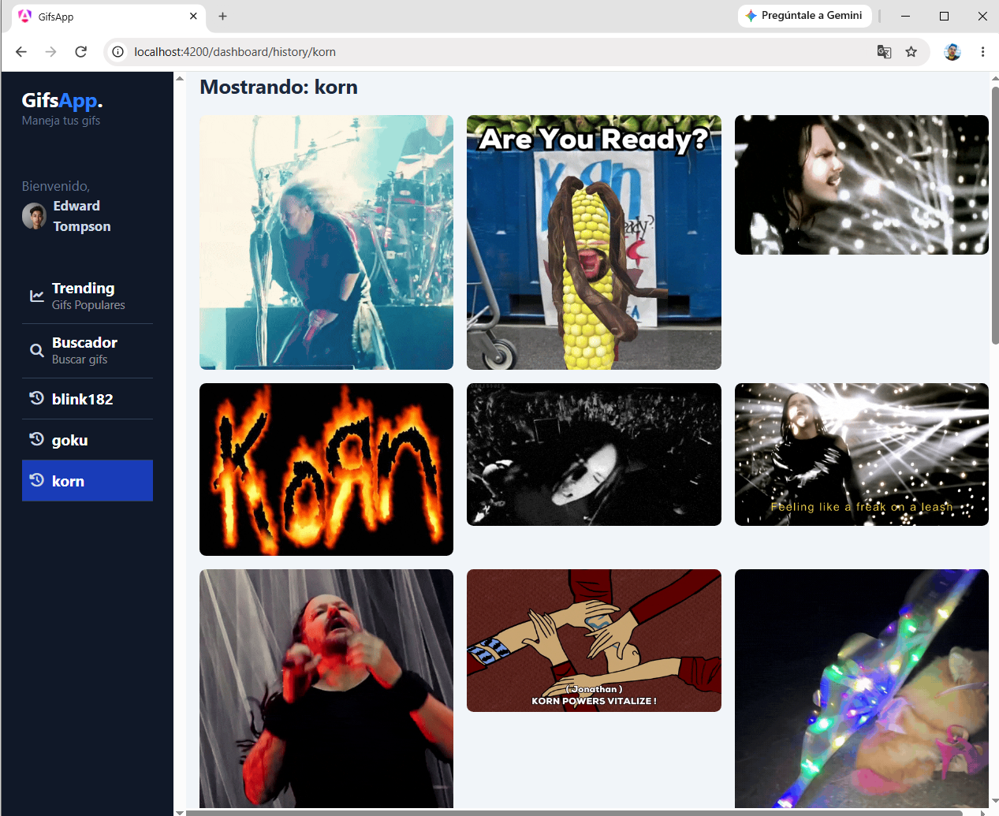

# Gifs App – Angular

A modern GIF search application built with **Angular 22**, **TypeScript**, and the **GIPHY API**. Explore trending GIFs, search for your favorite animations, and revisit your search history.

## Live Demo

**Production:** [https://gifs-app-angular-one.vercel.app](https://gifs-app-angular-one.vercel.app)

[](https://vercel.com/)

## Screenshots

### Trending GIFs

Explore the most popular GIFs with an infinite scrolling experience.



### GIF Search

Search for GIFs using keywords and explore the results.



### Search History

Access previous searches and revisit your favorite topics.



## Features

- **Trending GIFs:** Explore the most popular GIFs using the GIPHY Trending API.
- **GIF Search:** Search for GIFs by keywords.
- **Search History:** Keep track of previous searches.
- **Persistent Storage:** Search history is saved using browser Local Storage.
- **Infinite Scrolling:** Automatically load more trending GIFs as you scroll.
- **Lazy Loading:** Load application pages on demand using Angular Router.
- **Responsive Interface:** Modern interface styled with Tailwind CSS.
- **Scroll Position Restoration:** Preserve the scrolling position when navigating between pages.

## Technologies

| Technology | Purpose |
|---|---|
| Angular 22 | Frontend framework |
| TypeScript | Programming language |
| RxJS | Reactive programming and HTTP streams |
| Angular Signals | Reactive state management |
| Angular Router | Application navigation |
| HttpClient | HTTP communication |
| Tailwind CSS 4 | Styling |
| GIPHY API | GIF data provider |
| Local Storage | Search history persistence |
| Node.js | Environment configuration script |
| Vercel | Deployment and hosting |
| GitHub | Source code management |

## Project Structure

```text
gifs-app-angular/
├── docs/
│   └── screenshots/
├── scripts/
│   └── set-env.js
├── src/
│   ├── app/
│   │   ├── gifs/
│   │   │   ├── components/
│   │   │   │   ├── gif-list/
│   │   │   │   └── side-menu/
│   │   │   ├── interfaces/
│   │   │   ├── mapper/
│   │   │   ├── pages/
│   │   │   │   ├── dashboard-page/
│   │   │   │   ├── gif-history/
│   │   │   │   ├── search-page/
│   │   │   │   └── trending-page/
│   │   │   └── services/
│   │   ├── shared/
│   │   │   └── services/
│   │   ├── app.config.ts
│   │   └── app.routes.ts
│   └── environments/
│       ├── environment.example.ts
│       └── environment.development.example.ts
├── angular.json
├── package.json
└── README.md
```

## Architecture Highlights

- **Services:** Centralize GIF API requests and application state.
- **Interfaces:** Define TypeScript contracts for GIF and GIPHY responses.
- **Mapper:** Transform GIPHY API responses into application models.
- **Signals:** Manage reactive application state.
- **Computed Signals:** Derive data such as grouped trending GIFs and search history keys.
- **Lazy Loading:** Improve application loading by loading pages on demand.
- **Environment Configuration:** Generate production environment settings dynamically using a Node.js script.

## Getting Started

### Prerequisites

- Node.js
- npm
- Angular CLI (optional, since the project includes Angular CLI as a dependency)
- A GIPHY API Key

### 1. Clone the repository

```bash
git clone https://github.com/freyderdev/gifs-app-angular.git
```

### 2. Navigate to the project directory

```bash
cd gifs-app-angular
```

### 3. Install dependencies

```bash
npm install
```

### 4. Configure the GIPHY API Key

Create your own API Key at [GIPHY Developers](https://developers.giphy.com/).

The environment configuration templates are located in:

```text
src/environments/
├── environment.example.ts
└── environment.development.example.ts
```

Copy the example files to create your local environment configurations.

**PowerShell:**

```powershell
Copy-Item src/environments/environment.example.ts src/environments/environment.ts

Copy-Item src/environments/environment.development.example.ts src/environments/environment.development.ts
```

Open both newly created files and replace:

```typescript
giphyApikey: 'YOUR_GIPHY_API_KEY',
```

with your own GIPHY API Key.

**Important:** Environment files containing local API credentials are excluded from Git. Never commit your personal API Key. Since this is a frontend application, API keys are visible to browser users; configure appropriate restrictions in your GIPHY developer dashboard.

### 5. Run the development server

```bash
npm start
```

Open your browser at:

```text
http://localhost:4200/
```

### 6. Build for production

The production build uses the `GIPHY_API_KEY` environment variable to generate the production environment configuration.

**PowerShell:**

```powershell
$env:GIPHY_API_KEY = "YOUR_GIPHY_API_KEY"

npm run build
```

The `scripts/set-env.js` script generates `src/environments/environment.ts` before Angular executes the production build.

The generated environment file is excluded from Git.

## Deployment

The application is deployed using [Vercel](https://vercel.com/).

**Production URL:**

[https://gifs-app-angular-one.vercel.app](https://gifs-app-angular-one.vercel.app)

### Deployment Configuration

- **Git Repository:** `freyderdev/gifs-app-angular`
- **Production Branch:** `main`
- **Framework Preset:** Angular
- **Build Command:** `npm run build`
- **Output Directory:** `dist/gifs-app/browser`

### Environment Variables

Configure the following environment variable in Vercel:

| Variable | Description |
|---|---|
| `GIPHY_API_KEY` | GIPHY API Key used during production builds |

Enable the variable for the **Production** and **Preview** environments.

### Continuous Deployment

Vercel is connected to the GitHub repository.

Every new push to the `main` branch triggers an automatic production deployment.

## Available Scripts

| Command | Description |
|---|---|
| `npm start` | Start the development server |
| `npm run build` | Generate the production environment and build the application |
| `npm run watch` | Build and watch for changes |
| `npm test` | Run unit tests |

## API Reference

This application uses the [GIPHY API](https://developers.giphy.com/docs/api/).

Endpoints used:

- **Trending GIFs:** `/gifs/trending`
- **Search GIFs:** `/gifs/search`

## Author

**Freyder Dev**

- GitHub: [@freyderdev](https://github.com/freyderdev)
- Repository: [gifs-app-angular](https://github.com/freyderdev/gifs-app-angular)

---

*Developed as part of my continuous learning journey with Angular and modern frontend development.*
